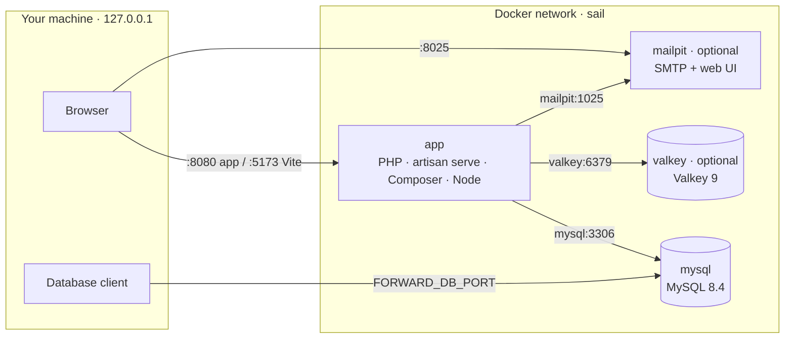

<h1 align="center">Laravel Docker Boilerplate</h1>

<p align="center">
  A <strong>configurable Laravel 13 boilerplate</strong> for local development with Docker and <strong>Laravel Sail</strong>.<br>
  Pick PHP, Node, Composer, extensions, services, versions and ports from a single <code>.env</code> file.<br>
  MySQL included, Valkey and Mailpit on demand. No PHP, Composer or Node on your machine: only Docker.
</p>

<p align="center">
  
  
  
  
  
  
  
</p>

<p align="center">
  <a href="#-configure-everything-from-env">Configure</a> ·
  <a href="#-quick-start">Quick start</a> ·
  <a href="#-documentation">Documentation</a> ·
  <a href="docs/configuration.md">Configuration</a> ·
  <a href="docs/troubleshooting.md">Troubleshooting</a>
</p>

---

## Table of contents

- [Configure everything from `.env`](#-configure-everything-from-env)
- [Why this boilerplate](#-why-this-boilerplate)
- [What's inside](#-whats-inside)
- [Requirements](#-requirements)
- [Quick start](#-quick-start)
- [Documentation](#-documentation)
- [Contributing](#-contributing)
- [Code of Conduct](#-code-of-conduct)
- [Security Vulnerabilities](#-security-vulnerabilities)
- [License](#-license)

---

## ✨ Configure everything from `.env`

This is the point of the boilerplate: **one template, any stack version**. You do not edit Dockerfiles or `compose.yaml` to change PHP, Node or MySQL: you change a line in `.env`.

```dotenv
# Runtime of the app image
PHP_VERSION=8.4
NODE_VERSION=22
COMPOSER_VERSION=2.8.4
PHP_EXTENSIONS="gmp"

# Services: turn the optional ones on or off, pick their versions
COMPOSE_PROFILES=valkey,mailpit
MYSQL_VERSION=8.4
VALKEY_VERSION=9

# Ports on your machine
APP_PORT=8080
FORWARD_DB_PORT=3307
```

```bash
./sail build
./sail up -d --wait
```

| What you can choose | Variables | Default |
|---|---|---|
| PHP runtime | `PHP_VERSION` | `8.5` (also `8.3`, `8.4`) |
| Node.js | `NODE_VERSION` | `24` |
| Composer | `COMPOSER_VERSION` | latest |
| Extra PHP extensions | `PHP_EXTENSIONS` | none |
| Optional services | `COMPOSE_PROFILES` | `valkey,mailpit` (both on) |
| MySQL, Valkey, Mailpit versions | `MYSQL_VERSION`, `VALKEY_VERSION`, `MAILPIT_VERSION` | `8.4`, `9`, `latest` |
| Ports and bind address | `APP_PORT`, `VITE_PORT`, `FORWARD_*`, `APP_BIND_ADDRESS` | `8080`, `5173`, random, `127.0.0.1` |

Leave a value empty and the boilerplate uses its default (the one exception is `COMPOSE_PROFILES`, where empty means no optional service). Every variable is explained in [Configuration](docs/configuration.md).

---

## 💡 Why this boilerplate

[Laravel Sail](https://laravel.com/docs/sail) is a great way to run Laravel in Docker, but a fresh `sail:install` is made for *one* project on *one* machine: its Docker files live in `vendor/`, ports are fixed, versions are hard-coded, and on a fresh clone the first `composer install` has to happen before Sail itself exists.

This template turns Sail into something you can clone and start in three commands:

- **Configurable from one file.** PHP, Node, Composer, extensions, service versions and ports all come from `.env`, with sensible defaults when you leave them empty.
- **Only the services you need.** Valkey and Mailpit are optional: an API that sends no email does not have to run a mail catcher.
- **Nothing to install but Docker.** PHP, Composer, Node and every extension live inside the container.
- **Builds from a fresh clone.** The Sail runtimes are published in `docker/`, so the image builds without `vendor/`.
- **Dependencies install themselves.** `composer install` runs every time the app container starts.
- **Survives Sail updates.** A publish script re-applies the boilerplate's changes every time you update Sail.
- **Files stay yours.** The container runs as your host user, so nothing in the project ends up owned by root.
- **Several projects side by side.** MySQL and Valkey get a free random host port unless you choose one.

> [!WARNING]
> This setup is for **local development only**. `php artisan serve` is not a production web server.

---

## 📦 What's inside

| Service | Image | Purpose | From your machine |
|---|---|---|---|
| `app` | built from `docker/<PHP_VERSION>` | PHP, Composer, Node, `php artisan serve` | http://localhost:8080 (Vite on `5173`) |
| `mysql` | `mysql:8.4` | Application database, plus a `testing` database for the test suite | `127.0.0.1` on a random port, or `FORWARD_DB_PORT` |
| `valkey` *(optional)* | `valkey/valkey:9-alpine` | Cache and queues through Laravel's `redis` driver | `127.0.0.1` on a random port, or `FORWARD_VALKEY_PORT` |
| `mailpit` *(optional)* | `axllent/mailpit:latest` | Catches every email the app sends | http://localhost:8025 |

The app and MySQL always run; Valkey and Mailpit start only when listed in `COMPOSE_PROFILES` (both are on by default). The `app` image is Sail's own runtime: Ubuntu 24.04 with PHP and the common extensions (MySQL, Redis, GD, Imagick, Intl, Swoole, Xdebug, PCOV, …), Composer, Node.js with npm, pnpm, Yarn and Bun, and the MySQL client.



Inside the Docker network the services reach each other by name (`mysql`, `valkey`, `mailpit`). From your machine you always go through `127.0.0.1` and the forwarded ports.

---

## ✅ Requirements

- **Docker Engine** with the **Compose plugin** (`docker compose`). Docker Desktop works too.
- **Linux, macOS or Windows with WSL 2.** On Windows, clone the project inside the WSL file system, not under `/mnt/c`.
- **Bash**, to run the setup script.
- **A regular user.** Never run the scripts or Sail with `sudo`: the container would take root's uid and create root-owned files in your project.

That's it. No PHP, Composer or Node on your machine.

---

## 🚀 Quick start

### 1. Create your project

Click **Use this template** on GitHub, or clone the repository:

```bash
git clone https://github.com/mattiaferraioli00/laravel-docker-boilerplate.git my-app
cd my-app
```

A clone keeps the template's Git history. To start your own, run `rm -rf .git && git init`. **Use this template** does that for you.

Or do it from the terminal with the [GitHub CLI](https://cli.github.com): it creates the repository on your account from this template and clones it, with a fresh history.

```bash
gh repo create my-app --template mattiaferraioli00/laravel-docker-boilerplate --private --clone
cd my-app
```

### 2. Create your `.env`

```bash
./scripts/sail/setup.sh
```

It copies `.env.example` to `.env` and fills the three values that are personal to you: your user id (`WWWUSER`), your group id (`WWWGROUP`) and a new application key (`APP_KEY`). If `.env` already exists, it only fills those values when they are empty: nothing you have set is overwritten.

### 3. Start the containers

```bash
./sail up -d --wait
```

The first run takes a few minutes: Docker builds the PHP image and the app container installs the Composer dependencies. `--wait` returns only when every service is healthy, which for `app` means the Laravel server is answering.

### 4. Create the database tables

```bash
./sail artisan migrate
```

### 5. Open the app

| What | Where |
|---|---|
| Laravel | http://localhost:8080 |
| Mailpit (emails) | http://localhost:8025 |

> [!TIP]
> Add this alias to your `~/.bashrc` or `~/.zshrc` to type `sail` instead of `./sail`. It uses the project's `./sail` when present and falls back to `vendor/bin/sail`:
>
> ```bash
> alias sail='sh $([ -f sail ] && echo sail || echo vendor/bin/sail)'
> ```
>
> The README and the docs write `./sail`, which works without any alias.

---

## 📚 Documentation

| Guide | What you will find |
|---|---|
| [How it works](docs/how-it-works.md) | The `./sail` script, what happens on startup, file permissions, ports |
| [Usage](docs/usage.md) | Daily commands, Vite, database, cache and queues, mail, tests, Xdebug, plain Docker Compose |
| [Configuration](docs/configuration.md) | Every `.env` variable, switching PHP version, extensions, services on and off, running several projects |
| [Customizing and updating Sail](docs/maintenance.md) | Where changes go, updating Sail with `publish.sh`, adding services, project structure |
| [Troubleshooting](docs/troubleshooting.md) | Common errors and how to fix them |

---

## 🤝 Contributing

This is an open-source project and every proposal to make it better is welcome. Read the [contribution guide](.github/CONTRIBUTING.md) to report a bug, propose an idea or open a pull request.

If this boilerplate saved you some time, a ⭐ on GitHub helps other people find it.

---

## 📜 Code of Conduct

To keep this project welcoming to everyone, please review and abide by the [Code of Conduct](.github/CODE_OF_CONDUCT.md).

---

## 🔒 Security Vulnerabilities

Please review the [security policy](.github/SECURITY.md) on how to report security vulnerabilities. Do not open a public issue.

---

## 📄 License

Released under the [MIT License](LICENSE).

The files in `docker/` and the `sail` script come from [Laravel Sail](https://github.com/laravel/sail), © Taylor Otwell, released under the MIT License.
