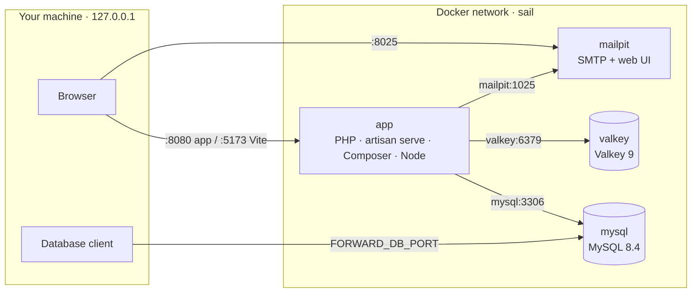
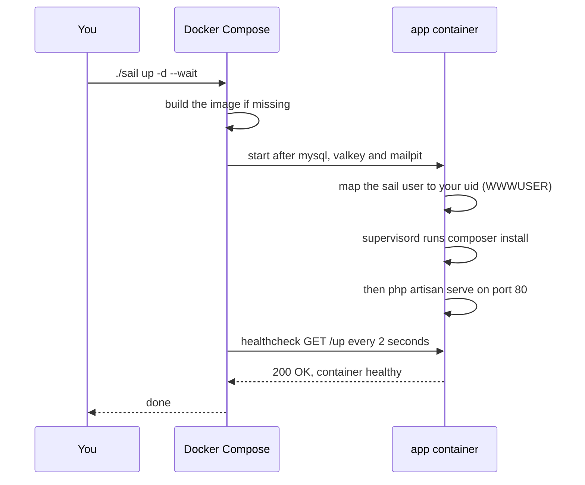

<h1 align="center">Laravel Docker Boilerplate</h1>

<p align="center">
  A <strong>configurable Laravel 13 boilerplate</strong> for local development with Docker and <strong>Laravel Sail</strong>.<br>
  Pick PHP, Node, Composer, extensions, service versions and ports from a single <code>.env</code> file.<br>
  MySQL, Valkey and Mailpit included. No PHP, Composer or Node on your machine: only Docker.
</p>

<p align="center">
  
  
  
  
  
  
  
</p>

<p align="center">
  <a href="#-configure-everything-from-env">Configure</a> ·
  <a href="#-quick-start">Quick start</a> ·
  <a href="#-daily-commands">Daily commands</a> ·
  <a href="#-configuration">Configuration</a> ·
  <a href="#-troubleshooting">Troubleshooting</a>
</p>

---

## Table of contents

- [Configure everything from `.env`](#-configure-everything-from-env)
- [Why this boilerplate](#-why-this-boilerplate)
- [What's inside](#-whats-inside)
- [Requirements](#-requirements)
- [Quick start](#-quick-start)
- [How it works](#-how-it-works)
- [Daily commands](#-daily-commands)
- [Configuration](#-configuration)
- [Frontend with Vite](#-frontend-with-vite)
- [Database](#-database)
- [Cache, queues and mail](#-cache-queues-and-mail)
- [Testing](#-testing)
- [Debugging with Xdebug](#-debugging-with-xdebug)
- [Using Docker Compose without Sail](#-using-docker-compose-without-sail)
- [Customizing and updating Sail](#-customizing-and-updating-sail)
- [Project structure](#-project-structure)
- [Troubleshooting](#-troubleshooting)
- [Contributing](#-contributing)
- [License](#-license)

---

## ✨ Configure everything from `.env`

This is the point of the boilerplate: **one template, any stack version**. You do not edit Dockerfiles or `compose.yaml` to change PHP, Node or MySQL: you change a line in `.env`.

```dotenv
# Runtime of the app image
PHP_VERSION=8.4
NODE_VERSION=22
COMPOSER_VERSION=2.8.4
PHP_EXTENSIONS="gmp"

# Services
MYSQL_VERSION=8.4
VALKEY_VERSION=9

# Ports on your machine
APP_PORT=8080
FORWARD_DB_PORT=3307
```

```bash
./sail build
./sail up -d --wait
```

| What you can choose | Variables | Default |
|---|---|---|
| PHP runtime | `PHP_VERSION` | `8.5` (also `8.3`, `8.4`) |
| Node.js | `NODE_VERSION` | `24` |
| Composer | `COMPOSER_VERSION` | latest |
| Extra PHP extensions | `PHP_EXTENSIONS` | none |
| MySQL, Valkey, Mailpit | `MYSQL_VERSION`, `VALKEY_VERSION`, `MAILPIT_VERSION` | `8.4`, `9`, `latest` |
| Ports and bind address | `APP_PORT`, `VITE_PORT`, `FORWARD_*`, `APP_BIND_ADDRESS` | `8080`, `5173`, random, `127.0.0.1` |

Leave a value empty and the boilerplate uses its default. Every variable is explained in [Configuration](#-configuration).

---

## 💡 Why this boilerplate

[Laravel Sail](https://laravel.com/docs/sail) is a great way to run Laravel in Docker, but a fresh `sail:install` is made for *one* project on *one* machine: its Docker files live in `vendor/`, ports are fixed, versions are hard-coded, and on a fresh clone the first `composer install` has to happen before Sail itself exists.

This template turns Sail into something you can clone and start in three commands:

- **Configurable from one file.** PHP, Node, Composer, extensions, service versions and ports all come from `.env`, with sensible defaults when you leave them empty.
- **Nothing to install but Docker.** PHP, Composer, Node and every extension live inside the container.
- **Builds from a fresh clone.** The Sail runtimes are published in `docker/`, so the image builds without `vendor/`.
- **Dependencies install themselves.** `composer install` runs every time the app container starts.
- **Survives Sail updates.** A publish script re-applies the boilerplate's changes every time you update Sail.
- **Files stay yours.** The container runs as your host user, so nothing in the project ends up owned by root.
- **Several projects side by side.** MySQL and Valkey get a free random host port unless you choose one.

> [!WARNING]
> This setup is for **local development only**. `php artisan serve` is not a production web server.

---

## 📦 What's inside

| Service | Image | Purpose | From your machine |
|---|---|---|---|
| `app` | built from `docker/<PHP_VERSION>` | PHP, Composer, Node, `php artisan serve` | http://localhost:8080 (Vite on `5173`) |
| `mysql` | `mysql:8.4` | Application database, plus a `testing` database for the test suite | `127.0.0.1` on a random port, or `FORWARD_DB_PORT` |
| `valkey` | `valkey/valkey:9-alpine` | Cache and queues through Laravel's `redis` driver | `127.0.0.1` on a random port, or `FORWARD_VALKEY_PORT` |
| `mailpit` | `axllent/mailpit:latest` | Catches every email the app sends | http://localhost:8025 |

The `app` image is Sail's own runtime: Ubuntu 24.04 with PHP and the common extensions (MySQL, Redis, GD, Imagick, Intl, Swoole, Xdebug, PCOV, …), Composer, Node.js with npm, pnpm, Yarn and Bun, and the MySQL client.



Inside the Docker network the services reach each other by name (`mysql`, `valkey`, `mailpit`). From your machine you always go through `127.0.0.1` and the forwarded ports.

---

## ✅ Requirements

- **Docker Engine** with the **Compose plugin** (`docker compose`). Docker Desktop works too.
- **Linux, macOS or Windows with WSL 2.** On Windows, clone the project inside the WSL file system, not under `/mnt/c`.
- **Bash**, to run the setup script.
- **A regular user.** Never run the scripts or Sail with `sudo`: the container would take root's uid and create root-owned files in your project.

That's it. No PHP, Composer or Node on your machine.

---

## 🚀 Quick start

### 1. Create your project

Click **Use this template** on GitHub, or clone the repository:

```bash
git clone https://github.com/mattiaferraioli00/laravel-docker-boilerplate.git my-app
cd my-app
```

A clone keeps the template's Git history. To start your own, run `rm -rf .git && git init`. **Use this template** does that for you.

### 2. Create your `.env`

```bash
./scripts/sail/setup.sh
```

It copies `.env.example` to `.env` and fills the three values that are personal to you: your user id (`WWWUSER`), your group id (`WWWGROUP`) and a new application key (`APP_KEY`). It never touches an existing `.env`.

### 3. Start the containers

```bash
./sail up -d --wait
```

The first run takes a few minutes: Docker builds the PHP image and the app container installs the Composer dependencies. `--wait` returns only when every service is healthy, which for `app` means the Laravel server is answering.

### 4. Create the database tables

```bash
./sail artisan migrate
```

### 5. Open the app

| What | Where |
|---|---|
| Laravel | http://localhost:8080 |
| Mailpit (emails) | http://localhost:8025 |

> [!TIP]
> Add this alias to your `~/.bashrc` or `~/.zshrc` to type `sail` instead of `./sail`. It uses the project's `./sail` when present and falls back to `vendor/bin/sail`:
>
> ```bash
> alias sail='sh $([ -f sail ] && echo sail || echo vendor/bin/sail)'
> ```
>
> The rest of this README writes `./sail`, which works without any alias.

---

## 🔍 How it works

### The `./sail` script

Sail is not a replacement for Docker: it is a Bash script that wraps `docker compose`. Before every command it reads your `.env`, works out your user and group ids, and then runs the matching `docker compose` command. Commands it does not know (`up`, `down`, `ps`, `logs`, `build`, …) are passed to `docker compose` as they are.

Sail normally lives in `vendor/bin/sail`, which does not exist until Composer has run. This template commits a copy at the project root (`./sail`, published with Sail's own `sail-bin` tag), so it works on a fresh clone.

### What happens on `./sail up -d --wait`



- **`composer install` on every start.** The command started by supervisord is overridden in `compose.yaml` (`SUPERVISOR_PHP_COMMAND`): it runs `composer install` and only then starts the server. With an up-to-date `vendor/` this takes a second. If Composer fails, the server does not start and the error shows up in `./sail logs app`.
- **Healthcheck on `/up`.** The app container is healthy when Laravel's built-in health route answers. That is what makes `--wait` reliable: the next command runs only after Composer has finished.
- **`php artisan serve`, not Nginx.** One process, nothing else to configure. It serves one request at a time; to handle concurrent requests, uncomment `PHP_CLI_SERVER_WORKERS` in `.env`.

### Users and file permissions

The project folder is mounted in the container at `/var/www/html`. To keep the files yours:

- At startup the container gives its `sail` user your uid (`WWWUSER`), and the image creates its group with your gid (`WWWGROUP`).
- Sail runs every command as that user (`exec -u sail`).
- Sail computes `WWWUSER` and `WWWGROUP` by itself on every command. The setup script also writes them in `.env` for tools that call `docker compose` directly.

### Ports

Every port is bound to `127.0.0.1` (`APP_BIND_ADDRESS`), so nothing is reachable from other machines on your network.

| Port | Variable | Default |
|---|---|---|
| Application | `APP_PORT` | `8080` |
| Vite dev server | `VITE_PORT` | `5173` |
| Mailpit dashboard | `FORWARD_MAILPIT_DASHBOARD_PORT` | `8025` |
| MySQL | `FORWARD_DB_PORT` | random free port |
| Valkey | `FORWARD_VALKEY_PORT` | random free port |

---

## 🧰 Daily commands

| Command | What it does |
|---|---|
| `./sail up -d --wait` | Start everything in the background and wait until it is healthy |
| `./sail stop` | Stop the containers, keep them |
| `./sail down` | Stop and remove the containers (data is kept in volumes) |
| `./sail down -v` | Same, **and delete the database and Valkey data** |
| `./sail ps` | Containers, health and ports |
| `./sail logs -f app` | Follow the logs of a service |
| `./sail artisan <command>` | Run an Artisan command |
| `./sail tinker` | Open Tinker |
| `./sail composer <command>` | Run Composer |
| `./sail test` | Run the test suite |
| `./sail pint` | Fix the code style |
| `./sail npm <command>` | Run npm (also `npx`, `pnpm`, `yarn`, `bun`) |
| `./sail shell` | Open a shell in the app container as your user |
| `./sail root-shell` | Open a root shell in the app container |
| `./sail mysql` | Open the MySQL client on the application database |
| `./sail valkey` | Open `valkey-cli` |
| `./sail port mysql 3306` | Show the host port of a service |

> [!NOTE]
> Commands that run inside a container (`artisan`, `composer`, `tinker`, `npm`, …) need the containers to be running. If they are not, Sail answers *"Sail is not running"*: start them with `./sail up -d --wait`.

---

## 🔧 Configuration

All settings live in `.env`. The file is split in two parts that behave differently:

| Part | An empty value means |
|---|---|
| **Laravel** (top of the file) | An empty string. To use Laravel's config default, comment the line out instead. |
| **Docker / Sail** (bottom of the file) | The default written in `compose.yaml` (`${VAR:-default}`) |

### Docker / Sail variables

| Variable | Default | Rebuild | Description |
|---|---|:---:|---|
| `APP_SERVICE` | `app` | | Name of the application service. Required: Sail would look for `laravel.test` |
| `APP_BIND_ADDRESS` | `127.0.0.1` | | Interface the ports are bound to |
| `APP_PORT` | `8080` | | Host port of the application. Keep it in sync with `APP_URL` |
| `VITE_PORT` | `5173` | | Host port of the Vite dev server |
| `FORWARD_DB_PORT` | random | | Host port of MySQL |
| `FORWARD_VALKEY_PORT` | random | | Host port of Valkey |
| `FORWARD_MAILPIT_DASHBOARD_PORT` | `8025` | | Host port of the Mailpit dashboard |
| `WWWUSER` / `WWWGROUP` | your uid / gid | | Written by the setup script, computed by Sail |
| `PHP_VERSION` | `8.5` | ✔ | PHP runtime: `8.3`, `8.4` or `8.5` |
| `NODE_VERSION` | `24` | ✔ | Node.js major version |
| `COMPOSER_VERSION` | latest | ✔ | Exact Composer version, e.g. `2.8.4` |
| `PHP_EXTENSIONS` | none | ✔ | Extra extensions, space separated, e.g. `"gmp apcu"` |
| `MYSQL_VERSION` | `8.4` | | MySQL image tag |
| `VALKEY_VERSION` | `9` | | Valkey image tag (`<version>-alpine`) |
| `MAILPIT_VERSION` | `latest` | | Mailpit image tag |

Variables marked **Rebuild** are build arguments of the app image. After changing one:

```bash
./sail build
./sail up -d --wait
```

The rebuild takes a few minutes, because these values are used by the step that installs PHP, Composer and Node.

### Examples

<details>
<summary><strong>Switch to PHP 8.3</strong></summary>

```bash
sed -i 's|^PHP_VERSION=.*|PHP_VERSION=8.3|' .env
./sail build
./sail up -d --wait
./sail php -v
```

The Composer platform is pinned to PHP 8.3 in `composer.json` (`config.platform.php`), so `composer.lock` stays installable on every supported runtime.

</details>

<details>
<summary><strong>Add PHP extensions</strong></summary>

Extensions are installed as `php<version>-<name>` packages, so use the package name without the prefix:

```bash
sed -i 's|^PHP_EXTENSIONS=.*|PHP_EXTENSIONS="gmp apcu"|' .env
./sail build
./sail up -d --wait
./sail php -m
```

Many common extensions are already in the image: check `./sail php -m` before adding one.

</details>

<details>
<summary><strong>Change the service versions</strong></summary>

```bash
sed -i 's|^MYSQL_VERSION=.*|MYSQL_VERSION=8.4|' .env
./sail up -d --wait
```

Services use ready-made images, so no rebuild is needed: Compose pulls the new tag.

**Careful with downgrades:** MySQL cannot go back to an older version on a data folder created by a newer one. Before a downgrade, run `./sail down -v`: it deletes the database.

</details>

<details>
<summary><strong>Run several projects at the same time</strong></summary>

MySQL and Valkey already get a random free port. The app, Vite and Mailpit ports are fixed, so change them in the second project's `.env`:

```dotenv
APP_PORT=8081
APP_URL=http://localhost:8081
VITE_PORT=5174
FORWARD_MAILPIT_DASHBOARD_PORT=8026
```

Each project gets its own containers, network, volumes and image, named after its folder.

</details>

---

## 🎨 Frontend with Vite

```bash
./sail npm install
./sail npm run dev
```

The Laravel Vite plugin detects Sail: the dev server listens inside the container and your browser loads the assets from `localhost:5173` (`VITE_PORT`). For a production build:

```bash
./sail npm run build
```

To pin the version of pnpm, Yarn or npm for the whole team, set the `packageManager` field in `package.json`: Corepack is enabled in the image.

---

## 💾 Database

| Setting | Value |
|---|---|
| Host from the app | `mysql` (port `3306`) |
| Host from your machine | `127.0.0.1`, port from `./sail port mysql 3306` |
| Database | `laravel` (and `testing` for the tests) |
| User / password | `sail` / `password` |
| Root password | same as `DB_PASSWORD` |

**Connecting with a database client** (DBeaver, TablePlus, PhpStorm, …): use `127.0.0.1` and the port shown by `./sail port mysql 3306`. The port is random and may change when the container is recreated; for a stable one, set `FORWARD_DB_PORT` (for example `3307`) in `.env` and run `./sail up -d`.

**The `testing` database** is created by `docker/mysql/create-testing-database.sh` the first time the MySQL volume is initialized. If your volume existed before, the script did not run: see [Troubleshooting](#-troubleshooting).

**Starting from scratch** deletes all data:

```bash
./sail down -v
./sail up -d --wait
./sail artisan migrate
```

---

## ⚡ Cache, queues and mail

- **Cache and queues** use Valkey through Laravel's `redis` driver (`CACHE_STORE=redis`, `QUEUE_CONNECTION=redis`). The `phpredis` extension is already in the image.
- **Queued jobs need a worker.** There is no worker container: jobs wait in Valkey until you run one.

  ```bash
  ./sail artisan queue:work
  ```

- **Sessions** are stored in the database (`SESSION_DRIVER=database`).
- **Mail** goes to Mailpit over SMTP. Nothing leaves your machine: open http://localhost:8025 to read every email the app sends.

---

## 🧪 Testing

```bash
./sail test
```

Tests run on the MySQL `testing` database (set in `phpunit.xml`), so your development data is never touched. Use `--filter` to run a single test:

```bash
./sail test --filter=ExampleTest
```

---

## 🐞 Debugging with Xdebug

Xdebug is installed but off by default.

1. Enable it in `.env`:

   ```dotenv
   SAIL_XDEBUG_MODE=develop,debug
   ```

2. Recreate the app container: `./sail up -d --wait`.
3. In your IDE, listen on port **9003** and map the project folder to **`/var/www/html`**.
4. Start a session:
    - **Artisan commands:** `./sail debug <command>`, e.g. `./sail debug migrate`.
    - **Browser requests:** use an Xdebug browser extension, or add `XDEBUG_TRIGGER=1` to the query string.

The container reaches your IDE through `host.docker.internal`, which is mapped to your machine in `compose.yaml` (on Linux too).

---

## 🐳 Using Docker Compose without Sail

Sail is optional: `compose.yaml` works with plain `docker compose`. Two things to know:

- `WWWUSER` and `WWWGROUP` must be in `.env`. The setup script writes them.
- `docker compose exec` runs as root by default. Always add `-u sail`, or the files you create will belong to root.

```bash
docker compose up -d --wait
docker compose exec -u sail app php artisan migrate
docker compose exec -u sail app composer require laravel/sanctum
docker compose logs -f app
```

---

## 🔨 Customizing and updating Sail

### Where changes go

| Change | Where |
|---|---|
| Versions, ports, extensions | `.env` |
| Services, healthchecks, startup command, build arguments | `compose.yaml` |
| Changes to Sail's Dockerfiles | `scripts/sail/publish.sh` |

**Do not edit the files in `docker/` by hand.** They are Sail's files: the next update overwrites them. Every change to them lives in `scripts/sail/publish.sh`, which re-applies it after each update. Today it adds the `COMPOSER_VERSION` build argument.

### Updating Sail

```bash
./sail composer update laravel/sail
./scripts/sail/publish.sh
git diff docker/ sail
./sail build --no-cache
./sail up -d --wait
```

`publish.sh` re-publishes Sail's Dockerfiles, database scripts and `./sail`, removes what the boilerplate does not use (PHP 8.0–8.2, MariaDB and PostgreSQL scripts) and re-applies the boilerplate changes. If Sail changed its Dockerfile so much that a change cannot be applied, the script stops with an error that says what to update. `compose.yaml` is never touched.

### Adding a service

```bash
./sail artisan sail:add
```

Sail adds the new service to `compose.yaml`, but it looks for the application service under its default name (`laravel.test`). It will warn you that it could not find it: add the new service to `app.depends_on` yourself.

---

## 📁 Project structure

Only the files added or changed by the boilerplate are listed; everything else is a standard Laravel 13 application.

```text
.
├── compose.yaml                 # services, ports, healthchecks, build arguments, startup command
├── sail                         # Sail CLI, committed so it works before composer install
├── .env.example                 # documented settings: Laravel on top, Docker / Sail below
├── docker/
│   ├── 8.3/  8.4/  8.5/          # PHP runtimes: Dockerfile, php.ini, supervisord.conf, start-container
│   └── mysql/
│       └── create-testing-database.sh
├── scripts/sail/
│   ├── setup.sh                 # creates .env with your uid, gid and an application key
│   └── publish.sh               # re-publishes Sail's files and re-applies the boilerplate changes
└── phpunit.xml                  # tests run on the MySQL testing database
```

---

## 🩺 Troubleshooting

<details>
<summary><code>sail: command not found</code></summary>

Sail is not installed system-wide: run it as `./sail`, or add the alias from the [Quick start](#-quick-start). Do not install the `bsdgames` package your system suggests: its `sail` is a game.

</details>

<details>
<summary><code>service "laravel.test" is not running</code></summary>

`APP_SERVICE=app` is missing from `.env`, so Sail looks for its default service name. Add it.

</details>

<details>
<summary><code>Sail is not running</code></summary>

The command runs inside a container and the containers are stopped. Start them with `./sail up -d --wait`.

</details>

<details>
<summary><code>Bind for 127.0.0.1:8080 failed: port is already allocated</code></summary>

Another container or program uses that port, often a second project started from this template. Stop it, or change the port in `.env` (see [Run several projects at the same time](#-configuration)).

</details>

<details>
<summary>The app container is <code>unhealthy</code> or <code>--wait</code> never ends</summary>

Look at the logs: usually `composer install` failed (network, incompatible lock file, missing extension).

```bash
./sail logs app
```

</details>

<details>
<summary><code>getaddrinfo for mysql failed</code></summary>

The app cannot resolve the `mysql` service: the MySQL container is stopped or detached from the network. Check with `./sail ps`, then recreate everything:

```bash
./sail down
./sail up -d --wait
```

</details>

<details>
<summary>The <code>testing</code> database does not exist</summary>

The script that creates it runs only on the first initialization of the MySQL volume. Recreate the volume (deletes the data):

```bash
./sail down -v
./sail up -d --wait
```

Or create it by hand:

```bash
./sail exec mysql mysql -u root -ppassword -e "CREATE DATABASE IF NOT EXISTS testing; GRANT ALL ON \`testing%\`.* TO 'sail'@'%';"
```

</details>

<details>
<summary>Files owned by root in the project</summary>

Something ran as root: `sudo`, or `docker compose exec` without `-u sail`. Give the files back to your user:

```bash
sudo chown -R "$(id -u):$(id -g)" .
```

</details>

<details>
<summary>Valkey warns about <code>Memory overcommit</code></summary>

It is a setting of your machine's kernel and only matters for background saves under low memory. It is safe to ignore locally. To silence it:

```bash
sudo sysctl vm.overcommit_memory=1
```

</details>

<details>
<summary>My IDE underlines the healthchecks in <code>compose.yaml</code></summary>

Some IDEs ship an outdated Compose schema. Docker Compose is the reference:

```bash
./sail config --quiet
```

No output means the file is valid.

</details>

---

## 🤝 Contributing

This is an open-source project and every proposal to make it better is welcome: a new configurable option, a clearer explanation in this README, a bug you hit on your machine, or a better way to do something that is already here.

- **Found a bug or have an idea?** [Open an issue](https://github.com/mattiaferraioli00/laravel-docker-boilerplate/issues) and describe what you expected, what happened, and your setup (operating system, `docker version`, the relevant lines of your `.env`).
- **Want to change something?** Fork the repository, create a branch and open a pull request that explains *what* changes and *why*.

A few guidelines keep the boilerplate consistent:

- **Keep it configurable.** New options belong in `.env`, with a sensible default when the value is empty, and are documented in `.env.example` and in this README.
- **Leave `docker/` alone.** Changes to Sail's Dockerfiles go in `scripts/sail/publish.sh`, so they survive Sail updates.
- **Test on a fresh clone.** Your working folder already has `vendor/`, a `.env` and a built image, so it hides problems. Before opening a pull request, check that the quick start works from zero:

  ```bash
  git clone <your-fork> /tmp/boilerplate-test
  cd /tmp/boilerplate-test
  ./scripts/sail/setup.sh
  ./sail up -d --wait
  ./sail artisan migrate
  ./sail test
  ./sail down -v
  ```

If this boilerplate saved you some time, a ⭐ on GitHub helps other people find it.

---

## 📄 License

Released under the [MIT License](LICENSE).
