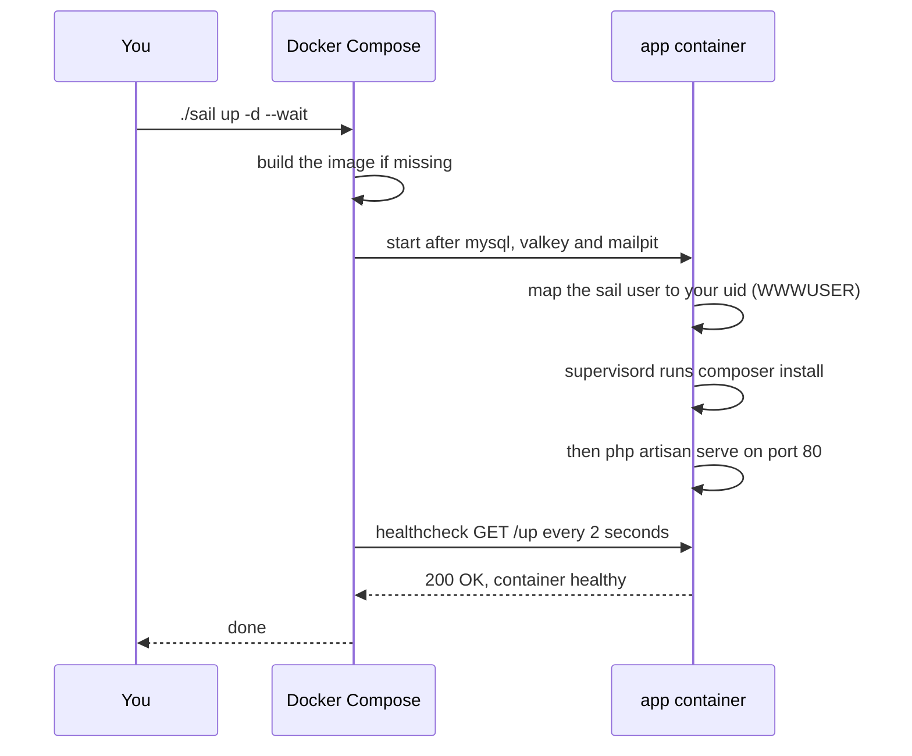

# How it works

[← Back to the README](../README.md)

What happens behind `./sail`: the wrapper script, the startup sequence, file permissions and ports.

## The `./sail` script

Sail is not a replacement for Docker: it is a Bash script that wraps `docker compose`. Before every command it reads your `.env`, works out your user and group ids, and then runs the matching `docker compose` command. Commands it does not know (`up`, `down`, `ps`, `logs`, `build`, …) are passed to `docker compose` as they are.

Sail normally lives in `vendor/bin/sail`, which does not exist until Composer has run. This template commits a copy at the project root (`./sail`, published with Sail's own `sail-bin` tag), so it works on a fresh clone.

## What happens on `./sail up -d --wait`

- **`composer install` on every start.** The command started by supervisord is overridden in `compose.yaml` (`SUPERVISOR_PHP_COMMAND`): it runs `composer install` and only then starts the server. With an up-to-date `vendor/` this takes a second. If Composer fails, the server does not start and the error shows up in `./sail logs app`.
- **Healthcheck on `/up`.** The app container is healthy when Laravel's built-in health route answers. That is what makes `--wait` reliable: the next command runs only after Composer has finished.
- **`php artisan serve`, not Nginx.** One process, nothing else to configure. It serves one request at a time; to handle concurrent requests, uncomment `PHP_CLI_SERVER_WORKERS` in `.env`.

## Users and file permissions

The project folder is mounted in the container at `/var/www/html`. To keep the files yours:

- At startup the container gives its `sail` user your uid (`WWWUSER`), and the image creates its group with your gid (`WWWGROUP`).
- Sail runs every command as that user (`exec -u sail`).
- Sail computes `WWWUSER` and `WWWGROUP` by itself on every command. The setup script also writes them in `.env` for tools that call `docker compose` directly.

## Ports

Every port is bound to `127.0.0.1` (`APP_BIND_ADDRESS`), so nothing is reachable from other machines on your network.

| Port | Variable | Default |
|---|---|---|
| Application | `APP_PORT` | `8080` |
| Vite dev server | `VITE_PORT` | `5173` |
| Mailpit dashboard | `FORWARD_MAILPIT_DASHBOARD_PORT` | `8025` |
| MySQL | `FORWARD_DB_PORT` | random free port |
| Valkey | `FORWARD_VALKEY_PORT` | random free port |

---

[← Back to the README](../README.md) · [Usage](usage.md) · [Configuration](configuration.md) · [Customizing and updating Sail](maintenance.md) · [Troubleshooting](troubleshooting.md)
